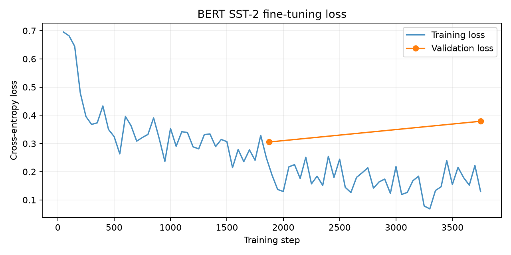
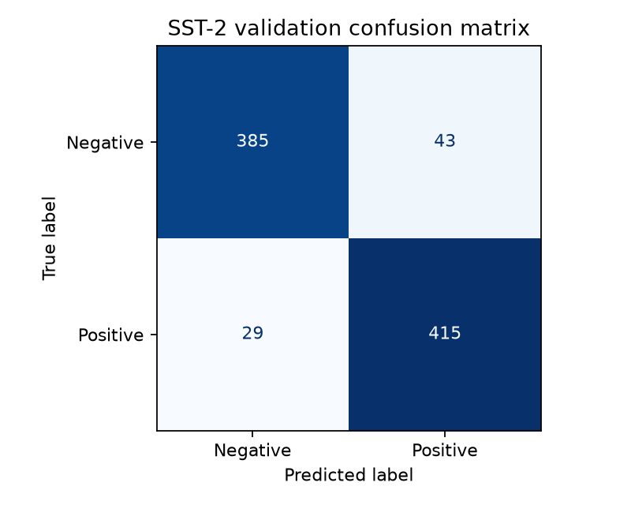

# BERT Fine-Tuning on GLUE SST-2

A reproducible BERT sentiment-classification project with an educational training notebook, saved local model, inference CLI, pytest coverage, and an optional Streamlit UI. The original Colab notebook remains preserved as historical experiment evidence.

## Verified training run

The clean notebook was executed on an NVIDIA GeForce RTX 4050 Laptop GPU (6 GiB VRAM), using Python 3.13.17, PyTorch 2.15.0+cu132, CUDA 13.2, Transformers 5.22.2, and Datasets 4.8.5. The run used FP16 at batch size 8 and completed without an out-of-memory fallback.

| Validation metric | Result |
|---|---:|
| Accuracy | 91.74% |
| Positive-class precision | 90.61% |
| Positive-class recall | 93.47% |
| Positive-class F1 | 92.02% |
| Cross-entropy loss | 0.3789 |

Confusion matrix (true labels as rows, predictions as columns; label order Negative, Positive):

```text
[[385, 43],
 [ 29, 415]]
```

Training took 6m 37s wall time, with peak allocated GPU memory of 1.64 GiB. Validation loss rose from 0.3054 after epoch 1 to 0.3789 after epoch 2, while validation F1 rose from 0.9087 to 0.9202. This pattern is a reason to compare seeds or add early stopping in future work; the current checkpoint is selected by validation F1 as configured.





### Historical result versus this run

The previous README recorded 90.94% validation accuracy, 0.2917 loss, and `checkpoint-938` for a separate 15k/2-epoch run with batch size 32 on a Tesla T4. The original notebook contains an earlier untrained evaluation (50.92% accuracy, 0.6914 loss), but no saved output for the final training cell; its checkpoint and trainer log are absent from the clone. Therefore those old values remain documented historical claims, not independently verified results. The results above come from the newly executed run and its saved validation artifacts. Neither run reports SST-2 test metrics.

## What the project does

- Fine-tunes `bert-base-uncased` for binary movie-review sentiment.
- Uses the first 15,000 rows of the official training split and keeps official validation data separate.
- Selects a checkpoint by validation F1, reports binary positive-class precision/recall/F1, accuracy, loss, a confusion matrix, a classification report, and actual validation errors.
- Saves model/tokenizer files for repeatable CPU or CUDA inference.

## Why BERT?

BERT is a bidirectional Transformer encoder pretrained to build contextual token representations. WordPiece tokenization turns text into input IDs; attention masks indicate real tokens versus padding. Self-attention lets each token use context from the rest of the sentence. Fine-tuning updates pretrained encoder weights together with a two-class head over the `[CLS]` representation. Cross-entropy measures the difference between class logits and labels; AdamW optimizes the model with a linear schedule and 10% warmup.

## Dataset

The notebook loads `nyu-mll/glue`, configuration `sst2`, with Hugging Face Datasets. SST-2 has English movie-review sentences labeled `0` (negative) or `1` (positive). The 15,000-example training subset is selected from the official train split. The official validation split has 872 examples and is used for checkpoint selection and all reported metrics. Test labels are hidden, so no test metric is computed. Sources: [GLUE](https://gluebenchmark.com/) and [Hugging Face GLUE dataset card](https://huggingface.co/datasets/nyu-mll/glue).

## Repository structure

```text
.
├── app.py
├── assets/
│   ├── confusion_matrix.png
│   └── loss_curves.png
├── bert_text_classification_sst2.ipynb  # original, preserved
├── notebooks/
│   └── bert_sst2_finetuning.ipynb       # executed training workflow
├── src/
│   ├── __init__.py
│   └── predict.py
├── tests/
│   ├── test_app.py
│   └── test_predict.py
├── requirements.txt
└── README.md
```

Generated checkpoints, cached datasets, and run records stay in ignored `models/` and `results/` folders. The current trained model is local at `models/best_model/`; the selected Trainer checkpoint is `results/baseline_15k_bs8/checkpoint-3750/`. Model weights are intentionally not committed.

## Setup

Use Python 3.11 or later. This project was verified with Python 3.13.17, PyTorch 2.15.0+cu132, CUDA 13.2, and the RTX 4050 Laptop GPU. For this checkout, activate the existing shared virtual environment one directory above the repository; do not create another environment:

```powershell
cd C:\Users\mittu\Documents\GitHub-Projects\bert-sst2-finetuning
..\.venv\Scripts\Activate.ps1
python -m pip check
```

For a new machine, create one virtual environment, install a matching PyTorch CPU/CUDA build using the [official selector](https://pytorch.org/get-started/locally/), and then install `requirements.txt`. The requirements include PyTorch so that fresh installs have the runtime; pip leaves an already-satisfied CUDA build in place. Avoid replacing a working CUDA wheel with a CPU-only build.

For CPU-only inference, install the CPU PyTorch build. For GPU training, use a compatible NVIDIA driver and CUDA-enabled PyTorch. The notebook checks CUDA and stops instead of silently running a full training job on CPU. A GPU is recommended; the measured run used an RTX 4050 Laptop GPU with 6 GiB VRAM.

The public dataset and pretrained weights download on first use, so initial training needs internet access. No Hugging Face token is required for these public files.

## Training

Open and run `notebooks/bert_sst2_finetuning.ipynb` top to bottom. The executed notebook records actual outputs and creates:

- `models/best_model/` — selected model and tokenizer.
- `results/run_config.json` — actual run settings and runtime/hardware metadata.
- `results/validation_metrics.json` — validation metrics, confusion matrix, and classification report.
- `results/trainer_log_history.json`, `results/loss_curves.png`, and `results/confusion_matrix.png`.

The baseline run used 15,000 training examples, max length 128, 2 epochs, batch size 8, evaluation batch size 8, FP16, learning rate `2e-5`, weight decay `0.01`, gradient accumulation 1, linear decay, 375 warmup steps, seed 42, and gradient clipping at 1.0. Checkpoint selection uses validation F1. If CUDA OOM occurs, the notebook clears memory and retries with batch size 4, then batch 4 with gradient checkpointing. It does not silently switch to CPU.

The notebook calls `load_dataset("nyu-mll/glue", "sst2")`. If prior outputs exist, each new notebook run uses a timestamped results/model directory to preserve them; use the saved `run_config.json` to find that run’s model path. For local Jupyter, install Jupyter separately with `python -m pip install jupyter` if it is not already available, then run:

```powershell
jupyter notebook notebooks/bert_sst2_finetuning.ipynb
```

## Inference

After training has saved the local model:

```powershell
python -m src.predict --model-dir models/best_model "A delightful, moving film." "A dull and predictable movie."
```

The command returns the text, `Positive`/`Negative` label, and both class probabilities. Long texts are truncated at 128 WordPieces. Empty or invalid inputs and missing/incomplete model files produce actionable errors. To call inference in Python:

```python
from src.predict import load_model, predict_sentiment

model, tokenizer = load_model("models/best_model")  # load once and reuse
predictions = predict_sentiment(
    ["A delightful film."], model=model, tokenizer=tokenizer
)
print(predictions[0])
```

## Optional Streamlit app

Install the optional UI dependency and start the app from the repository root:

```powershell
python -m pip install streamlit
streamlit run app.py
```

The model is cached as a Streamlit resource so it is not loaded again on every rerun. The interface includes sample positive, negative, and mixed reviews, displays both class probabilities, and explains that predictions are estimates that can be wrong.

## Tests and checks

```powershell
python -m pytest -q
python -m pip check
```

Tests use mocked model components, so they do not retrain or download model weights. The app's empty-input handling is tested with a mocked Streamlit interface.

## Limitations and next steps

- Validation results are from one seed; they are not a guarantee of performance on other domains or future examples.
- Validation loss increased in epoch 2 even though F1 improved; early stopping or multiple-seed comparisons may be useful.
- SST-2 contains short English movie-review sentences. Sarcasm, domain shift, other languages, and long documents may reduce performance.
- Softmax probabilities are model estimates, not calibrated confidence intervals.
- The SST-2 test labels are hidden and were not used for model selection or evaluation.

## References

- Devlin et al., [BERT: Pre-training of Deep Bidirectional Transformers for Language Understanding](https://arxiv.org/abs/1810.04805).
- Wang et al., [GLUE: A Multi-Task Benchmark and Analysis Platform for Natural Language Understanding](https://aclanthology.org/W18-5446/).
- Hugging Face [Transformers](https://huggingface.co/docs/transformers), [Datasets](https://huggingface.co/docs/datasets), and [GLUE dataset card](https://huggingface.co/datasets/nyu-mll/glue).
